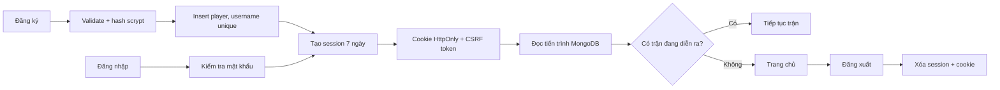
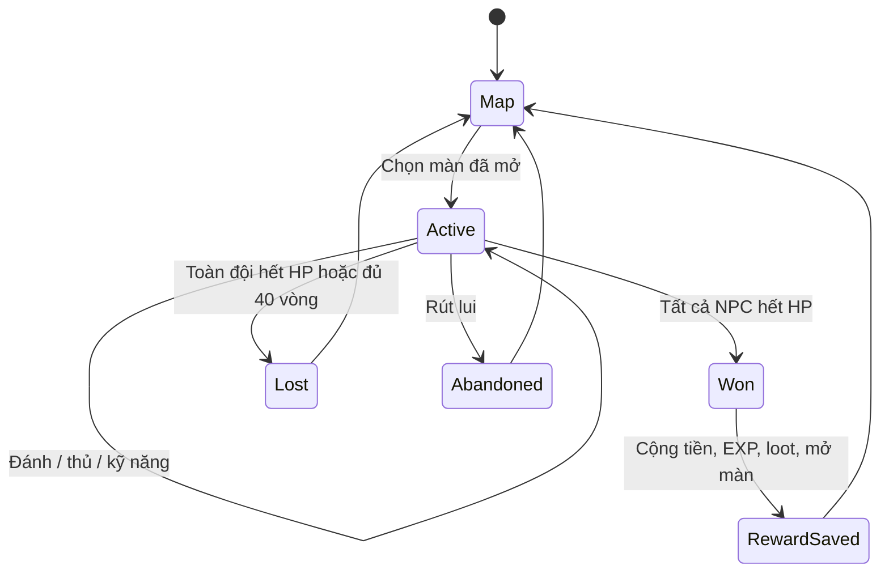

# Luồng dữ liệu và luật game

## Tài khoản và phiên

Tên tài khoản unique theo chữ thường. Session token ngẫu nhiên 32 byte chỉ nằm trong cookie; database lưu SHA-256 token. `passwordHash`/session hash không nằm trong API player. Mỗi POST game yêu cầu `X-CSRF-Token` và `Idempotency-Key`; frontend tạo UUID mới cho mỗi thao tác. Đăng nhập/đăng ký được giới hạn tần suất, không dùng CSRF của một phiên chưa tồn tại. Origin có mặt phải trùng origin server.

## Schema MongoDB

`players`: `_id`, `usernameKey`, `passwordHash`, `createdAt`, `updatedAt`, `player`.

`player` gồm:

- `version`: tăng mỗi thao tác được ghi.
- `displayName`, `wallet {gold, diamonds}`, `account {level, exp}`.
- `hero {id, level, exp, stars, rank, skills, equipment}` là tướng đang dùng; `reserveHeroes` lưu các tướng còn lại theo ID. Có `luffy-gear-2` và `zoro-king-of-hell`. API trả thêm `heroes` để dựng danh sách tướng sở hữu. Không chuyển tướng trong trận.
- `inventory`: map `itemId → quantity`, không tính những bản đã mặc.
- `adventure {unlockedStage, cleared, wins, lastDaily, afk}`; `afk {since, ticks, gold, accountExp, spirit}` là đồng hồ và phần đã chốt của rương tự động đánh ải. API trả thêm `afk {state, seconds, stageCode, rate, spiritPerStone, pending}` đã tính sẵn theo giờ server.
- `formation {version:2, slots}`: sáu ô chứa ID tướng hoặc `null`; không trùng tướng, có ít nhất một tướng sở hữu. Chọn tướng ở màn chi tiết không đổi đội hình.
- `tower {floor, turns, day}`: tiến trình Leo đậu thần; API trả `tower {floor, turns, maxTurns, maxFloor, floors}` với bốn tầng kế tiếp.
- `battle`: snapshot thuộc tính lúc bắt đầu, seed PRNG server, turn, HP/nộ/cooldown, NPC, event log, status, reward. Trận mới có `combatVersion:2`, `allies` và `enemies` (mỗi bên tối đa sáu). `hero` là bản tương thích của đồng minh đầu tiên; không dùng HP riêng tướng này để quyết định thua.
- `receipts`: kết quả của 150 mã thao tác gần nhất; `activity`: 100 sự kiện gần nhất.

`sessions`: `userId`, `tokenHash`, `csrfToken`, `createdAt`, `expiresAt`. TTL index xóa phiên hết hạn; middleware luôn kiểm tra thời hạn nên không phụ thuộc thời điểm TTL chạy.

## Giao dịch tiền và inventory

Server đọc document hiện tại → clone player → validate và áp dụng luật → ghi bằng filter `{_id, player.version}`. Chỉ ghi thành công nếu version chưa đổi. Nếu có request đồng thời, đọc lại và thử tối đa 10 lần. Vàng, nguyên liệu, trạng thái trận, thưởng và receipt được lưu cùng một lần ghi nguyên tử; lỗi giữa luồng không ghi nửa chi phí.

Receipt so sánh cả ID và fingerprint nội dung. Cùng ID/cùng nội dung trả lại kết quả, không thực hiện lần hai; cùng ID/nội dung khác trả 409. Riêng battle kiểm tra cả battle ID, số lượt và trạng thái `active`, nên trận kết thúc không thể cộng lại thưởng kể cả receipt đã bị loại khỏi cache.

## Chỉ số và nâng cấp

| Hạng mục | Luật prototype |
| --- | --- |
| Cấp thuyền trưởng | Cần `100 × cấp hiện tại` EXP mỗi cấp; tối đa 100 |
| Cấp tướng | `140 × level` vàng + `45 × level` EXP tướng |
| Trần level tướng | `min(60, level thuyền trưởng × 5 + 5)` |
| Sao | Tối đa 6; cần level `sao × 5`, `1.000 × sao` vàng, `8 × sao` mảnh Luffy |
| Bậc | Tối đa 5; cần level `(bậc + 1) × 3`, `700 × (bậc+1)` vàng, `3 × (bậc+1)` đá |
| Kỹ năng | `250 × cấp kỹ năng` vàng + cùng số sách; trần `min(3, 2 + bậc × 2)`; giữ nguyên cấp cũ cao hơn trần |
| Điểm danh | 1.500 vàng, 50 kim cương, 2 thịt nướng; ngày theo UTC+7 |

`heroStats()` cộng chỉ số cơ bản theo level/sao/bậc, nội tại Haki Vũ Trang hoặc Enma của tướng đang dùng và chỉ số trang bị. Lực chiến là chỉ số tham khảo do server tính. Mặc đồ trừ một bản khỏi kho, tháo đồ trả lại kho; đổi đồ trả bản cũ và dùng bản mới trong cùng cập nhật. Không nâng cấp/đổi đồ/dùng đồ trong trận để giữ rõ snapshot chiến đấu.

Đồ mua và bán dùng giá catalog server; client chỉ gửi ID và quantity nguyên 1–99. Bán một món mua bằng vàng luôn nhận ít vàng hơn giá mua. Gói kim cương được định giá bằng kim cương để tránh vòng đổi tiền vô hạn.

## Thám hiểm và lượt đánh

Một lượt API là một vòng: sắp xếp toàn bộ nhân vật còn sống theo tốc độ hiệu lực giảm dần; mỗi nhân vật có một lượt, bỏ qua nhân vật đã bị hạ trước khi đến lượt. Hòa tốc độ ưu tiên đồng minh rồi vị trí. HP, nộ, hồi chiêu và nội tại lưu riêng từng nhân vật. Hết toàn bộ địch thì thắng; hết toàn bộ đồng minh hoặc đủ 40 vòng thì thua. Luffy bị hạ không khiến Zoro dừng đánh.

Đánh thường ưu tiên hàng trước còn sống; Zoro chọn mục tiêu có HP tuyệt đối thấp nhất theo Enma. Mỗi tướng tự dùng chiêu khi đủ nộ và hết hồi chiêu. Đánh thường tăng 35 nộ; nhận đòn tăng 12; phòng thủ tăng 20. Roi Cao Su tiêu hao 80 nộ, hồi chiêu hai vòng tiếp theo, hồi đồng minh sống có tỷ lệ HP thấp nhất, tối đa phần HP thiếu. Zoro tiêu hao 100 nộ, có thể kích hoạt thêm tối đa một lần qua Đòn Quyết Định. Haki hàng trước/sau, buff, debuff và thời hạn tính trên từng tướng. Trận cũ chưa có `combatVersion:2` vẫn kết thúc theo engine cũ để giữ snapshot đã lưu.

Sát thương = `max(1, round((attack × multiplier − defense × 0,6) × random(0,94..1,06)))`. PRNG seed lưu trong battle trên server. Client không quyết định số damage, coin hay loot. Các trường giả `damage`/`rewards` gửi kèm bị bỏ qua.

Thưởng lấy từ bảng phụ bản gốc: vàng, EXP thuyền trưởng, EXP từng tướng xuất chiến và vật phẩm rơi. EXP tướng cũng cộng cho tướng bị hạ; tiền/vật phẩm chỉ cộng một lần cho cả đội. Chỉ mở màn kế tiếp sau chiến thắng. Không có phí rút lui hoặc mất đồ khi thua. Trận từ bản 12 ải cũ giữ lịch thưởng cũ.

Client phát event log tuần tự: áp sát → animation `beat` → hit tại 0,36s; tuyệt kỹ `skill3` → hit tại 0,73s rồi phát trọn animation. Event `heal`, `buff`, `effect-expired` cập nhật máu và biểu tượng trạng thái, với hiệu ứng hồi máu gốc. Pose `damage` quay về `idling` sau khoảng 0,2s. Idle luôn loop; tốc độ ×2 chỉ thay thời gian trình chiếu, không thay luật sát thương/thưởng.

## Rương tự động đánh ải

Từ ải đầu tiên đã qua, cứ 5 giây là một tick, cộng theo tốc độ gốc `G/EXP/S` (cột `output` của `db_vuotai`) của ải cao nhất đã qua. Server tính giờ, client gửi `{}` và chỉ nội suy để hiển thị. Cấu hình ở `economy.afk` trong `server/catalog.mjs`, logic ở `server/afk.mjs`.

| Thời gian tích lũy | Rương | Spine |
| --- | --- | --- |
| Dưới 1 phút, hoặc chưa qua ải nào | Trống, chưa nhận được | `Empty` |
| 1 phút đến dưới 1 giờ | Đóng, nhận được | `Full` |
| Từ 1 giờ | Tràn vàng, nhận được | `Full2` |
| 10 giờ | Vẫn `Full2`, ngừng tích lũy | `Full2` |

Bấm nhận phát `Open` rồi về `Empty`. `G` cộng vào vàng, `EXP` vào EXP thuyền trưởng. `S` cộng thẳng vào Đá EXP, tức EXP tướng: 1 S = 1 viên = 1 EXP. Nhận nhiều lần hay một lần đều ra cùng số. Qua ải mới sẽ chốt phần đã có theo tốc độ cũ rồi mới đổi tốc độ; giới hạn 10 giờ tính gộp qua các lần đổi. Tài khoản cũ bắt đầu đếm từ lần tải đầu tiên sau khi có tính năng, không cộng hồi tố. Không nhận được trong trận.

## API

| Method | Route | Body chính |
| --- | --- | --- |
| GET | `/api/health` | Trạng thái kết nối |
| GET | `/api/catalog` | Hero, item, stages, visuals, economy |
| POST | `/api/auth/register` | `username, password` |
| POST | `/api/auth/login` | `username, password` |
| GET | `/api/auth/session` | Player và CSRF token |
| POST | `/api/auth/logout` | `{}` |
| GET | `/api/state` | Player hiện tại |
| POST | `/api/wallet/daily` | `{}` |
| POST | `/api/shop/buy` | Đã đóng: luôn trả 410 `SHOP_CLOSED`. Cửa hàng chỉ để xem |
| POST | `/api/items/use` | `itemId, quantity` |
| POST | `/api/items/sell` | `itemId, quantity` |
| POST | `/api/hero/upgrade` | `type: level/star/rank/skill`, `skillId` khi nâng skill |
| POST | `/api/hero/select` | `heroId`: chuyển tướng đang dùng và giữ riêng tiến trình/trang bị |
| POST | `/api/hero/equip` | `itemId` |
| POST | `/api/hero/unequip` | `slot` |
| POST | `/api/formation` | `slots`: sáu ID tướng hoặc `null` |
| POST | `/api/adventure/start` | `stageId, formation`: sáu ô |
| POST | `/api/items/choose` | `itemId, avatar`: dùng vật phẩm chọn tướng |
| POST | `/api/summon` | `faction, count`: chiêu mộ x1 hoặc x10 |
| GET | `/api/tower/ranking` | Top 50 và thứ hạng của bản thân, đọc từ `tower_ranking` |
| GET | `/api/beast` | Mùa, lượt, quà chờ nhận |
| GET | `/api/beast/boss/:key` | Chỉ số, top 100, thưởng của một boss |
| POST | `/api/beast/start` | Khiêu chiến: `boss, formation, skip` |
| POST | `/api/beast/claim` | Nhận quà tổng kết |
| POST | `/api/tower/start` | `formation?`: vào tầng hiện tại, giữ một lượt |
| POST | `/api/adventure/afk-claim` | `{}`: nhận toàn bộ rương; rương trống trả 409 `AFK_EMPTY` |
| POST | `/api/battle/action` | `battleId, turn, action: attack/skill/defend/auto, targetId?` |
| POST | `/api/battle/leave` | `{}` |

POST game trả `{player, result, replayed}`. `player` là trạng thái mới từ MongoDB, có `costs` và chỉ số tính sẵn; client cập nhật các màn từ dữ liệu này. Lỗi trả `{error:{code,message}}` với status 400/401/403/404/409/429 phù hợp.

## Leo đậu thần

Chế độ Đơn lấy 2.301 tầng từ `db_tower` qua `tools/export-tower.py` vào `dist/tower.json`: quái theo `db_quai.link` → `db_heroes`, thưởng vàng, `promostone` thành Đá đột phá, `item`/`item_use`/`shard` thành vật phẩm tương ứng trong catalog. Mỗi ngày (UTC+7) có 5 lượt; lượt bị giữ khi vào trận, thắng thì hoàn lại, thua hoặc rút lui thì mất. Thắng tăng `player.tower.floor`, trận lưu tầng lúc bắt đầu nên thưởng không thể nhận hai lần. Chỉ số quái dùng công thức của phụ bản, với `power` của tầng quy về ải có cùng sức mạnh (`towerStrength`). Bảng xếp hạng nằm trong collection `tower_ranking` (`userId, displayName, heroId, level, floors, reachedAt, hidden`), cập nhật ngay trong `Store.mutate` khi số tầng, tên, cấp hoặc tướng đổi, và đồng bộ lại toàn bộ từ `players` lúc server khởi động. `GET /api/tower/ranking` đọc thẳng từ collection: 50 dòng đầu và dòng của người đang đăng nhập. `floors` là số tầng đã vượt; cùng số tầng thì `reachedAt` sớm hơn xếp trên. Tài khoản bị khóa có `hidden` và không hiện. Hạm đội chưa có hệ thống nên để trống. Chế độ Đôi (`db_tower2`) và lịch sử chưa làm. Luật ở `server/tower.mjs`.

## Chiến Thần Thú

Vào từ đảo Chiến Thần Thú trên bản đồ thế giới (scene 53, chi tiết boss là scene 1600, cả hai xuất từ prefab `popupbossofworld` và `popuptopboss` trong bundle `lua_ex`). Luật lấy từ `bossofworldscene.lua`, `popuptopboss.lua`, `popupbossreward.lua`: 5 boss Sea King, Nola, Dragon 13, Oars, Smiley; mỗi boss chỉ nhận một nghề, tướng phải đạt cấp tối thiểu, hai trận cách nhau 15 giây, có Bỏ qua chiến đấu, thưởng theo 10 mốc 1, 2, 3, 4, 5, 6-10, 11-20, 21-50, 51-100, 100+.

Dữ liệu trong MongoDB, tạo một lần lúc khởi động và không bị asset ghi đè:

| Collection | Nội dung |
|---|---|
| `beast_bosses` | Cấp, tấn công, giáp, máu, tốc độ của 5 boss. Số đầu lấy từ cột `point` của `db_heroes`; máu nhân thêm cấp 330 |
| `beast_rewards` | 10 mốc thưởng của từng boss |
| `beast_config` | Số ngày mỗi mùa, lượt mỗi mùa, giây chờ, số vòng tối đa, cấp tướng tối thiểu |
| `beast_seasons` | Các mùa và trạng thái `active`, `settling`, `settled` |
| `beast_ranking` | Một dòng cho mỗi cặp mùa, boss, người chơi: 5 bảng riêng biệt |
| `beast_payouts` | Quà tổng kết đã chốt, chờ người chơi nhận |

Trận đấu: boss là một đơn vị `endless`, hết thanh máu thì đầy lại và cộng dồn `damageTaken`. Boss chỉ có skill 100208, đánh tất cả, mỗi mục tiêu mất 20% máu tối đa, không quá 1500% công, không né hay miễn được. Trận dừng khi đội ngã hết hoặc đủ số vòng; rút lui vẫn tính sát thương đã gây. Mỗi mùa boss đổi hệ và kỹ năng theo 5 dòng `db_quai`: Lì Đòn giảm 99% đòn chí mạng, Thôn Phệ giảm 99% đòn nộ, Cứng Cáp chặn xuyên giáp và sát thương chuẩn; Bá Vương chặn hiệu ứng bất lợi nên Cuồng Nộ không còn gì để xóa; Miễn Dịch giảm sát thương cuối lượt nhưng hệ chiến đấu chưa có loại đó. Đòn đánh thường của boss không có trong asset nên không làm.

Sát thương cộng dồn trong `player.beast` cùng lượt ghi với đòn cuối, rồi chép sang `beast_ranking`; lúc khởi động bảng mùa hiện tại được đồng bộ lại từ `players`. Trận kéo sang mùa mới không tính. Hết hạn, `beastTick` chốt cả 5 bảng theo thưởng đang có trong `beast_rewards`, ghi `beast_payouts`, mở mùa kế; tài khoản bị khóa không nhận. Người chơi thấy popup Quà tổng kết khi vào màn đảo. Nhận quà dùng `player.beast.claimed` nên không thể nhận hai lần.

Asset không có bảng thưởng vì server gốc giữ. Hạng 1 đến 4 theo ảnh gốc; các mốc sau là số giảm dần tự đặt, sửa ở trang quản trị. Mua thêm lượt chưa làm vì ảnh gốc ẩn nút này.

## Tiệm đồ và trang bị

Tiệm đồ là `ForgeScene` (scene 21), mở từ nút Tiệm đồ ở màn hình chính. Số liệu do `tools/export-equipment.py` xuất từ `db_item_equipment`, `db_equipment_set`, `db_point_view` vào `dist/equipment.json`, thay số cũ trong `game-catalog.json`.

- Phẩm: cột `color` của database chỉ là nhãn. Màu thật theo ảnh và thứ tự từ thấp lên cao: `blue` xám, `yellow` lục, `purple` lam, `green` tím, `red` vàng, `orange` đỏ. Món đỏ 6 sao có lấp lánh `Item_effect`, nướng thành dải ảnh bằng `tools/bake-item-effect.cjs` để lưới nhiều icon vẫn nhẹ.
- Công thức: mỗi ô 16 món ghép từ 3 món liền trước và vàng `forge_cost`. Món không có công thức lấy từ rơi đồ. Đồ có công thức hoặc từ phẩm 3 trở lên không bán ở Cửa hàng; bán lại theo `sell_price`.
- Chỉ số: `point_desc` là các cặp mã, giá trị; mã phần trăm nhân `num_rate`. Dòng `clazz` khác 0 chỉ tính khi đúng nghề tướng (1 Pháp sư, 2 Chiến binh, 3 Mục sư, 4 Xạ thủ, 5 Sát thủ); Luffy Gear 2 tính là Chiến binh.
- Bộ: 12 bộ, mỗi bộ 4 món. Hiệu ứng thứ 1, 2, 3 mở ở 2, 3, 4 món và cộng dồn.
- Chiến đấu: ST Kỹ năng, Chí mạng, ST Chí mạng, Xuyên thủ, Chính xác, Chặn, Giảm ST, Miễn chống đều có tác dụng trong `team-combat.mjs`. Đòn bị chặn còn 50%; tỷ lệ chặn là Chặn trừ Chính xác; Giảm ST tối đa 90%. Asset không ghi hai con số này nên là giả định.

## Chiêu mộ

Màn `SummonOrbScene`: chọn hệ Nhanh nhẹn, Sinh khí, Bền bỉ hoặc Chính xác rồi chiêu mộ x1, x10 bằng Thùng bia (`consumable:16`). Tỉ lệ nằm ở `economy.summon.rates`: SS 3%, S 12%, A 35%, B trở xuống 50%. Đây là số tự đặt vì bảng gốc không có trong dữ liệu client. Lần thứ mười chắc chắn ra bậc A trở lên nếu chín lần trước chưa có. Mỗi tài khoản được tặng 10 thùng một lần; mua thêm ở Cửa hàng giá 100 kim cương. Tướng mới vào `reserveHeroes` như Zoro nên nâng cấp, trang bị, chọn tướng và xếp đội hoạt động bình thường. Tướng đã có đổi thành 8 mảnh; Luffy, Zoro dùng mảnh riêng, tướng khác dùng Mảnh tướng 5 sao (`shard:30000`). Tài khoản có `collection` cũ được chuyển tự động. Tướng chiêu được đánh theo luật chung: chỉ số lấy công thức thử nghiệm nhân hệ số bậc và lớp (`statScale`), đủ 100 nộ dùng tuyệt kỹ đọc từ mô tả gốc (`ultimateFrom`): số mục tiêu, cách chọn mục tiêu (máu thấp nhất, nộ cao nhất, ngẫu nhiên, hàng sau, hàng trước), % Công nhân số lần đánh nén về 150–400%, hồi máu, tăng Công cho bản thân hoặc toàn đội; mỗi cấp kỹ năng +10%. Nội tại và hiệu ứng khác (khiên, choáng, đốt...) chưa được mô phỏng, chúng chỉ hiển thị ở hồ sơ. Luật ở `server/summon.mjs`.

## Hiệu ứng chiêu của tướng

`tools/export-hero-effects.py` đọc `cast_effs`, `impact_effs`, `split_dmgs` của `db_battle_heroes` vào `dist/hero-effects.json`; client chỉ tải hiệu ứng của tướng trong đội. Luffy Gear 2 và Zoro King Of Hell giữ luồng riêng. Quy tắc đặt trong `spawnHeroSkill`: `sorting_layer` BeyondCanvas là cutscene, phóng theo khung cắt để phủ kín màn; `origin_pos_type` 1 là tọa độ chiến trường, quy đổi 64 px mỗi đơn vị, nhân 1,37 quanh tâm đội địch; loại khác đặt trên mục tiêu. Animation nền (`Bgr`, `backgroud`...) vẽ sau nhân vật. Cả chuỗi được nén về tối đa 3,4 giây, sát thương rơi ở mốc `split_dmgs` đầu tiên. `tools/qa-hero-effects.cjs` tải mọi hiệu ứng, lấy mẫu dòng thời gian của từng tướng và xuất bảng ảnh vào `qa-output/hero-effects/`.

## Spine

`dist/spine-clipping.js` áp dụng `blendMode` của slot vì runtime canvas chỉ đọc mà không dùng; thiếu lớp này ảnh Additive lộ nền đen. `dist/vendor/spine-canvas.js` có một sửa cục bộ trong `BinaryInput.readString`: đọc byte không dấu để giải mã đúng tên phần tử UTF-8 trong `.skel`. Thiếu dòng này, Hero_546 và Hero_471 không tải được. Khi thay runtime, cần giữ lại hoặc dùng bản đã sửa; `tools/qa-summoned-battle.cjs` tải toàn bộ Spine tướng để phát hiện.

## Vật phẩm từ cache

`tools/export-all-items.py` so bốn bảng `db_item_*` trong cache với `game-catalog.json` và xuất phần còn thiếu vào `dist/items-extra.json`. Dòng không có tên hoặc không có ảnh bị bỏ qua vì là bộ đếm nhiệm vụ, sự kiện. Các món này có `extra` và `noShop`: không mua, không bán được, nguồn là trang quản trị. Bảo vật mới mặc được với chỉ số theo công thức cũ. Vật phẩm tiêu hao và mảnh mới chỉ hiển thị, chưa có công dụng.

## Rương

`tools/export-chests.py` đọc cột `preview` của `db_item_consumable` vào `dist/chests.json`. Mã phần thưởng: `1,N` vàng; `2,N` kim cương; `3,loại,id,N` vật phẩm (loại 1 tiêu hao, 2 và 3 mảnh); `5,id` tướng; `7,id,cấp,N` bảo vật. Vật phẩm `type 2` là rương ngẫu nhiên, `type 3` là rương tự chọn. Phần thưởng thuộc hệ thống chưa có (thú cưng, avatar, trái ác quỷ) bị bỏ; rương không còn gì thì không mở được. Bảng gốc không có tỉ lệ, nên trong rương ngẫu nhiên mọi phần thưởng có cơ hội ngang nhau, không lặp trong một lượt; số phần thưởng mỗi lượt đọc từ mô tả. Tướng đã có đổi thành mảnh. `POST /api/items/open` nhận `itemId` kèm `count` (1–10, rương ngẫu nhiên) hoặc `index` (rương tự chọn). Luật ở `server/chests.mjs`.

## Vật phẩm chọn tướng

`consumable:53` (SS, trừ hai hệ hiếm) và `consumable:54` (SS, hai hệ hiếm Thông minh, Minh mẫn) có `choice {rank, factions}` trong `server/catalog.mjs`. Nút Dùng mở bảng Có thể nhận, chọn một tướng rồi gọi `/api/items/choose`; server tự kiểm tra tướng thuộc danh sách của vật phẩm. Tướng đã có đổi thành mảnh như chiêu mộ trùng. Hai vật phẩm có `noShop`, không mua được; nguồn hiện tại là trang quản trị.

## Mảnh tướng

Mỗi tướng trong album có một vật phẩm `heroshard:<avatar>`, ảnh là đầu tướng kèm `icon_shard`. Đủ 60 mảnh ghép thành tướng đó (`POST /api/items/merge`); đã có tướng thì mảnh dùng để lên sao, và trùng tướng khi chiêu mộ cũng trả về mảnh riêng. Asset chỉ có cột `hero_shard_id`, `hero_shard_num` nên 60 lấy từ đó. `Mảnh tướng 5 sao` (`shard:30000`) vẫn là mảnh chung: 50 mảnh ghép ra ngẫu nhiên một tướng từ 5 sao trở lên, theo `number_merge`.

Thưởng tầng dùng số trong cột `other` khi có, vì `item_use_number` của các tầng sau không được cập nhật.

## Điểm danh và Sự kiện

Điểm danh dựng theo `PopupCheckin`: 30 ô, mỗi ngày nhận một ô theo thứ tự, không mất ô khi bỏ ngày, đủ 30 ô quay lại đầu, mốc ngày là 00:00 giờ Việt Nam. Route vẫn là `/api/wallet/daily`. Ô 1-10 theo ảnh gốc, ô 11-15 đúng vật phẩm trong ảnh nhưng số lượng bị che, ô 16-30 tự đặt.

Sự kiện là `EventScene` (scene 10), ba tab Sự kiện tuần, Sự kiện tháng, Ưu đãi. Asset chỉ có giao diện; danh sách và phần thưởng do server gốc giữ, nên toàn bộ nằm trong `server/events.mjs`, chỉ hai mốc Quay 20 và Quay 50 lượt theo ảnh. Có ba loại: `progress` (mốc theo bộ đếm), `exchange` (đổi vật phẩm có hạn lượt), `pray` (tiêu Hoa Đào, thưởng ngẫu nhiên kèm mốc). Sự kiện tuần làm mới thứ Hai, còn lại làm mới ngày 1 hằng tháng. Bộ đếm: `summon`, `tower`, `beast`, `forge`, `stage`, tăng trong cùng lượt ghi với hành động gốc. Route: `POST /api/event/claim`, `/api/event/exchange`, `/api/event/pray`.

Vật phẩm Beli và Đá EXP theo giờ (`consumable:60-71`) trả theo tốc độ rương tự động của ải cao nhất. Không Gian Vỡ theo `GGBrokenSpaceEventV2` (nền `event_46_big` đúng kích thước prefab): 7 cứ điểm, mỗi trận tốn 1 Ống nhòm (mô tả vật phẩm ghi dùng cho sự kiện tháng - khiêu chiến), địch lấy từ tầng đậu thần, vượt hết thì sang vòng mới, cứ mỗi vòng tăng 40 tầng. Thắng mới mở cứ điểm kế; thua hoặc rút lui mất Ống nhòm. Mua thêm 50 kim cương, tối đa 10 lần mỗi tháng. Route: `POST /api/event/stage`, `/api/event/buy`.

## EXP tướng

EXP tướng (lá xanh `icon_spirit`, ô `TextSpirit`) là quỹ chung trong `wallet.spirit`, không thuộc từng tướng. Cột `spirit` của ải và Thịt nướng cộng vào quỹ, còn Đá EXP chính là quỹ; nâng cấp tướng nào cũng trừ từ quỹ. Bản trước cộng riêng vào từng tướng và chia mỗi trận cho mọi tướng ra trận (6 tướng nhận 6 lần); lần đầu tài khoản được đọc, EXP cũ của mọi tướng được gộp vào quỹ một lần.

## Sao và thức tỉnh

Theo prefab `HeroStars`: sao 1-5 vàng (`hero_star_1`), 6-9 tím (`hero_star_2`), 10 đỏ (`hero_star_3`), 11-15 là cánh `star_e_bgr` với số L1-L5. Lên sao 1-5 cần mảnh tướng và vàng như trước; từ sao tím trở lên cần 50 mảnh (từ sao đỏ: 100), thêm Đá cường hóa và vàng tăng theo bậc. Cấp tối đa là 60 tới 5 sao, sau đó 20 + 10 × số sao (sao tím 3 = 100, L5 = 170), vẫn giới hạn theo cấp thuyền trưởng. Bảng nguyên liệu thức tỉnh gốc nằm ở server nên số nguyên liệu là tự đặt.

Thẻ chọn tướng (Tuỳ chọn L1, L2) trả 50 mảnh của tướng đã chọn; 50 mảnh ghép thành tướng, hoặc dùng nâng sao nếu đã có. Thông báo chữ dùng khung `bgr_toast` của prefab `Toast`.

## Cấu hình sự kiện

Bộ mặc định nằm trong `server/events.mjs`; bản sửa ở trang quản trị (tab Sự kiện) lưu trong collection `event_config`, một bản ghi cho mỗi sự kiện và một bản ghi `checkin`. Server chỉ nhận các trường được sửa của từng loại (tên, mốc, gói đổi, tỉ lệ, cứ điểm, quà ngày) và giữ nguyên id, loại, bộ đếm, ảnh. Lưu xong áp ngay vào bộ nhớ server; màn sự kiện, điểm danh và Lễ Hội Ẩm Thực tải lại cấu hình (`GET /api/events`) mỗi lần mở.

Lễ Hội Ẩm Thực mở từ nút cạnh Sự kiện ở màn hình chính, dựng theo `PopupSpecialEvent2` với ba tab: cửa hàng `PanelEventFeast` (đổi bằng Cỏ 4 lá và Xu vòng quay), Vòng Quay May Mắn (14 ô, quà ngày ở giữa, mốc số lần quay) và Điểm Danh Lễ Hội theo `PanelEventRollCall` (bỏ cột trả phí). Ảnh nền vòng quay gốc không có trong asset nên dùng `bg_gem`.

Sự kiện thêm: Chiêu Mộ Thuyền Viên 4 Sao (đếm tướng hạng 4 trở lên khi chiêu mộ), Tiêu Kim Cương Tháng (mọi lần trừ kim cương), Ghép Thuyền Viên 5 Sao (ghép mảnh ra tướng hạng 5 trở lên). Hiến Tế Thuyền Viên chưa làm vì game chưa có tính năng hiến tế.

## Màn kết thúc trận

Mọi trận dùng chung màn theo `PopupBattleEnd`: Spine `Win` hoặc `Lose_op` (xuất bằng `tools/export-battle-end.py` vì prefab nạp lúc chạy), `decor_win`, `decor_lose`, `bgr_win_lose`, ô thưởng, tổng sát thương và Battle Id. Thua hiện ba lối tắt Tiệm đồ, Chiêu mộ, Tướng. Nút chia sẻ của prefab không làm.

## Hòm thư

Thư nằm trong `player.mail`. Admin cộng vật phẩm, vàng hoặc kim cương thì đồ được gửi thành một thư, có tiêu đề và nội dung tùy chọn; người chơi bấm Nhận hoặc Nhận nhanh mới vào túi. Số âm trừ ngay. Thư còn quà không xóa được và không bao giờ bị tự xóa. Route: `POST /api/mail/claim` (`id` hoặc `all`), `POST /api/mail/delete`.

## Trang quản trị

`/admin` bật khi `ADMIN_PASSWORD` trong `.env` có từ 12 ký tự, không đặt thì `/api/admin/*` trả 404. Phiên quản trị riêng 8 giờ, lưu trong bộ nhớ server (khởi động lại phải đăng nhập lại), cookie `ht_admin` chỉ gửi cho `/api/admin`, mọi POST cần header `X-Admin-CSRF`. Đăng nhập dùng chung giới hạn 20 lần mỗi 15 phút. Tính năng: tìm tài khoản, xem chỉ số và túi đồ, thêm hoặc trừ vật phẩm, vàng, kim cương, khóa tài khoản (đăng xuất ngay và chặn đăng nhập). Mọi thay đổi ghi `admin_log` và đi qua kiểm tra `player.version` như thao tác game. API không trả `passwordHash`.

## Danh sách tướng

Màn Tướng mở danh sách đã sở hữu, lọc theo hệ, có nút Sắp xếp xoay vòng Cấp → Sao → Lực chiến và ô đếm `sở hữu/30`. Nút `i` mở danh sách tất cả tướng; nút quay lại trả về danh sách đã sở hữu, giữ nguyên hệ đang lọc. Bấm thẻ mở hồ sơ tướng chỉ để xem, gồm ảnh, bậc, hệ, lớp, chỉ số cấp tối đa và kỹ năng.

`dist/hero-album.json` và `dist/hero-profiles.json` do `tools/export-hero-album.py` xuất từ `db_heroes`, `db_hero_skill`: mỗi avatar một tướng có `release = 1`, id dưới 10000, xếp id giảm dần; hồ sơ tải khi mở lần đầu. Tướng chỉ được đưa vào danh sách khi đủ ảnh thẻ, ảnh lớn, bốn chỉ số và tên, mô tả, icon của mọi kỹ năng khai báo. `rank` 6/5/4/3/2/1 là bậc SS/S/A/B/C/D. Chỉ số hồ sơ lấy thẳng từ `point` của dòng sao cao nhất (Công, Thủ, Máu, Tốc độ), không qua công thức `heroStats()` của bản thử nghiệm. Client so `avatar` để biết tướng nào đã sở hữu. Thẻ trong danh sách tất cả tướng hiển thị cấp 250 và một sao theo ảnh gốc; server chưa có luật nhận tướng mới. Con số 30 cũng chỉ hiển thị, chưa chặn gì.

## Bổ sung sau

Thêm hero mới vào `heroDefinitions`, catalog/visuals và luồng cấp tướng trong `hero-roster.mjs`; mã hero dùng ID ổn định, không dùng tên hiển thị làm khóa. Nguồn và luật riêng Zoro xem [ZORO-KING-OF-HELL.md](ZORO-KING-OF-HELL.md). Thêm màn ở `stages`, `battleBackgrounds` và cấu hình NPC. Thay luật thử nghiệm trong `server/game.mjs`/`catalog.mjs`; không đưa luật thưởng hoặc URI MongoDB vào frontend.

## Đá hộ mệnh và dùng nhiều vật phẩm

- Ô thứ 6 ở tab Trang bị là ô Đá hộ mệnh (`stone_lock_1` khi khóa). Ô mở ở tướng cấp 30 và nhận Đá Xanh 1 sao với một dòng chỉ số ngẫu nhiên. Dữ liệu 26 bậc lấy từ `db_hero_stone` qua `tools/export-hero-stones.py` vào `dist/hero-stones.json`.
- Nâng cấp lên bậc kế tiếp tốn vàng và Bụi ma thuật (`consumable:3`) theo `upgrade_cost`. Có `gem_retain_effect`% giữ nguyên dòng, còn lại quay dòng mới. Hoán đổi tốn `convert_cost` và đổi sang dòng khác cùng bậc.
- Chỉ số của dòng đang chọn được cộng như trang bị qua `equipmentBonus(...,stoneGroups(hero))`. Chỉ số 13 (ST Chuẩn) cộng vào `trueDamage`.
- Vật phẩm Đá Cam (`consumable:60004`) lắp Đá Cam 1 sao nếu viên đang có thấp hơn.
- Các API: `/api/hero/stone/unlock`, `/api/hero/stone/upgrade` và `/api/hero/stone/convert`.
- Vật phẩm dùng được mà có từ 2 trở lên sẽ mở hộp "Dùng" theo PopupUseItemConsume (−, ô số, +). `use` nhận tối đa 1e9 mỗi lần.
- QA: `node tools/qa-stones.cjs`.

### Đá EXP là quỹ EXP tướng

- Đá EXP (`consumable:1`) và lá xanh EXP tướng trên thanh tiền là cùng một số: 1 viên = 1 EXP, lưu ở `wallet.spirit`.
- `addItem` và `spendItems` chuyển `consumable:1` vào ví. Màn hình người chơi hiện `inventory['consumable:1']` bằng `wallet.spirit`, nên Đá EXP không còn nút Dùng.
- Save cũ có Đá EXP trong túi được cộng vào `wallet.spirit` khi tải (`ensureRoster`).
- Rương tự động đánh trả 1 Đá EXP cho mỗi điểm spirit, nên tổng EXP không đổi.

## Đảo Người Cá: Album và Vực thẳm

- Nguồn: bundle `imgalbum` (db_album, PanelAlbumMain), `event_abyss` (MainScene, PopupAbyssEnemy), `event_daonguoica` + `lua_ex` (MerMaidBgr, MerMaidCanvas). Xuất bằng `tools/export-mermaid.py` ra `dist/album.json`, `dist/abyss.json`, `dist/mermaid.json` và scene 1700.
- Bản đồ thế giới: `B_PlaceHolder3` là MermaidIsland (theo LuaJobFixImageIslandMermaid). Ở scene 1700, nút Vực thẳm (`ButtonNui`) và Album (`ButtonSach`) mở màn DOM trong `dist/mermaid-ui.js` + `mermaid.css`; Thế giới quay lại scene 37.
- **Album** (`server/album.mjs`): 120 ảnh, 14 album. Mỗi lần Rút tốn 50 Thẻ huyền bí (`consumable:100045`) và mở một mảnh chưa có. Mở nửa số mảnh nhận lại 100 thẻ. Ảnh mở khi đã hoàn thành `required_image_id` và thuyền trưởng đạt `required_level`. Ảnh đủ mảnh cộng `buff_data` cho mọi tướng qua `equipmentBonus(...,albumGroups(player))`; chỉ số 97 (Lục thức) chỉ hiện ở Tổng chỉ số.
- **Vực thẳm** (`server/abyss.mjs`): 20 ải, mỗi ải 3 nhiệm vụ = 3 sao (thắng; thắng với ≥2 / ≥3 tướng hệ của ải). Ải sau mở khi đã thắng ải trước. Mỗi ải 3 lượt/ngày, mua thêm 50 kim cương/lượt, tối đa 5 lượt/ngày. Đội địch là đội tướng như `PbUser.team` gốc (`stageEnemies`): Ải 1 đúng ảnh gốc — Killer, Zoro - S ở hàng trước; Luffy - S, Califa, Akainu, Caesar ở hàng sau; cấp 160, 7 sao, lực chiến 318.338. Ải 2–20 không có trong asset nên dựng cùng khuôn: 2 tướng hệ của ải ở hàng sau và 4 tướng hệ khác, mạnh dần theo ải; cấp theo db_tower (tầng 200+50(n−1)), sao 7 + ⌊(n−1)/4⌋, lực chiến nhân theo tỉ lệ lực chiến tầng. Chỉ số trong trận vẫn theo sức mạnh của tầng đó. Popup ải hiện đội địch và lực chiến địch. Rương nhiệm vụ nhận riêng; Rương kho báu mở một ô mỗi 6 sao, chọn 1 trong 3 phần quà. Mùa 7 ngày bắt đầu thứ Hai 00:00 (UTC+7), hết mùa làm mới tất cả.
- Thưởng, giá lượt và tên hệ cho các ải sau ải 1 là giá trị tự đặt vì bảng gốc nằm ở server game.
- API: `/api/album/roll`, `/api/abyss/start|claim|buy|milestone`. QA: `node tools/qa-mermaid.cjs`.

### Đảo Người Cá: nhân vật và animation

- Theo `MerMaidEvent`, `MermaidHeroController`, `MermaidCameraFollow`, `MermaidHero`, 1 đơn vị thế giới = 64px.
- Người chơi:
  - Là hero 190, scale 1.5, xuất phát ở (11, -2). Chạm đất thì chạy tới với tốc độ 4.5 đơn vị/giây (animation `run`, tới nơi về `idling`) và không lên quá y = -1.8. Chỗ chạm hiện hiệu ứng `HitMove` (`hit`).
  - Camera bám theo người chơi, giới hạn trong khoảng BgrStart..BgrEnd (-4.54..17.84).
- NPC:
  - Gồm hero 178, Chopper_mini (MermaidHeroMuaKeoBong, `IDLE`/`RUN`) và Zoro 331, đặt ngẫu nhiên trong khoảng x -3..25, cách nhau ít nhất 5.
  - Đi qua lại như `MoveRandomHero`: sang trái 7 giây với tốc độ 0.75, đứng, sang phải, rồi nghỉ 120 giây.
  - Có dấu "!" (icon_notify). Chạm vào NPC thì người chơi chạy tới và NPC nói một câu trong `db_daonguoica_bot_quest`. Mini-game của NPC chưa làm.
- Trang trí là spine của MerMaidBgr: 3 nàng tiên cá (maid1-3), 3 bong bóng, mây và rong biển. Dưới chân mỗi nhân vật có bóng (`shadow`).
- Vực thẳm: rương nhiệm vụ đã hoàn thành dùng spine `ChestSpine` (skeleton, `animation`) thay ảnh tĩnh.
- Album: mỗi lần Rút phát hiệu ứng `OpenFragement` (`mo the tuong`) ở mảnh vừa mở.

## Thành tựu

Nút Thành tựu ở sảnh mở `PopupMasteringHero` (tab Thành tựu = `BoxGameChallenge`, mỗi dòng là `CellGameChallenge`) dựng bằng DOM trong `achievementDialog` (`dist/game.js`, `dist/achievement.css`) với sprite gốc: `popup_notitle_2`, `tab_active`/`tab_inactive`, `round_rect_17`, `bgr_light`, `progress_mastering_quest(_2)`, `bgr_item_consumable`, `border_item`, `button_red`, `tick_green`, `button_close_4`. Luật ở `server/achievements.mjs`, action `achievement-claim` (`POST /api/achievement/claim`). Câu chữ lấy từ `server_message` gốc. Mốc và quà nằm ở server gốc nên không có trong asset: mốc đầu thưởng 10K Beli + 50 kim cương như ảnh gốc, mốc thứ n thưởng n lần. Có: Đạt cấp (10…100), Sở hữu thuyền viên 4/5/6/7/8/9/10/13/15 sao (1, 3, 5, 10), Vượt tầng Tháp Lãng Quên (= db_tower), Triệu hồi Cao Cấp (đếm từ `player.stats.summons`). Dòng nhận được xếp đầu, dòng đã nhận hết xếp cuối với dấu tích. QA: `tools/qa-achievements.cjs` (cả hai tab).

## Thông